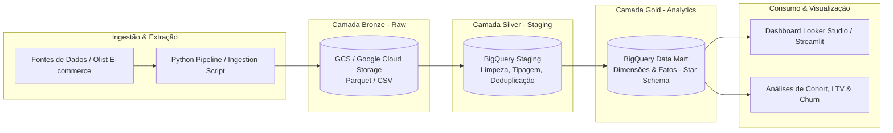

# 🛒 Enterprise GCP E-Commerce Modern Data Platform

[](https://geovana28.github.io/gcp-ecommerce-lakehouse/)
[](https://colab.research.google.com/github/Geovana28/gcp-ecommerce-lakehouse/blob/main/notebooks/01_ecommerce_analytics_colab.ipynb)
[-blue?style=for-the-badge)](https://github.com/Geovana28/gcp-ecommerce-lakehouse)
[](LICENSE)

Pipeline de Engenharia e Análise de Dados ponta a ponta (*End-to-End*) utilizando a **Arquitetura Medalhão (Bronze ➔ Silver ➔ Gold)** no ecossistema **Google Cloud Platform (GCP)** com **BigQuery**, **Cloud Storage**, **Python** e modelagem dimensional (*Star Schema*).

> 💡 **Experimente a Demonstração Interativa:** Acesse o [**Interactive Showcase (GitHub Pages)**](https://geovana28.github.io/gcp-ecommerce-lakehouse/) para explorar os simuladores de SLA, gráficos interativos de lead time e a modelagem formal sem precisar clonar ou instalar nada.

---

## 🏗️ Arquitetura da Solução



---

## 🎯 Objetivos de Negócio

1. **Visão 360° do Cliente e Vendas**: Acompanhar ticket médio, faturamento por região, tempo de entrega e taxa de recompra.
2. **Eficiência Logística**: Medir desvio entre tempo estimado vs. tempo real de entrega por estado/cidade.
3. **Qualidade do Serviço & Reviews**: Identificar correlação entre atrasos na entrega e notas baixas de avaliação de pedidos.

---

## 📂 Estrutura do Repositório

```
gcp-ecommerce-lakehouse/
├── ddl/
│   ├── bronze_gcs.sql          # Configuração e tabelas externas no GCS
│   ├── silver_staging.sql      # Transformações e limpeza (Staging)
│   ├── gold_marts.sql          # Modelagem Dimensional (Fatos e Dimensões)
│   └── looker_views.sql        # Views otimizadas para o Looker Studio
├── notebooks/
│   └── 01_ecommerce_analytics_colab.ipynb  # Análise inferencial e ML no Google Colab
├── src/
│   ├── ingestion/              # Ingestão para o GCS
│   └── utils/                  # Helpers e conexões GCP
├── requirements.txt            # Dependências Python
└── README.md
```

---

## 📊 Visualização no Looker Studio & Google Colab

### 1. Google Colab (Laboratório de Dados & ML)
Acesse a análise exploratória e modelo preditivo com um clique:  
[](https://colab.research.google.com/github/Geovana28/gcp-ecommerce-lakehouse/blob/main/notebooks/01_ecommerce_analytics_colab.ipynb)

* Análise estatística de dispersão do tempo de entrega ($P_{50}$ e $P_{95}$).
* Matriz de correlação de atrasos vs. quebra de SLA.
* Classificador com Scikit-Learn para predição precoce de atraso.

### 2. Conexão com o Looker Studio
As views em `ddl/looker_views.sql` foram desenhadas para conexões instantâneas:
* `ecommerce_gold.vw_looker_daily_kpis`: Monitoramento diário de volume de pedidos, taxa de atraso e conformidade com o SLA.
* `ecommerce_gold.vw_looker_regional_performance`: Análise geográfica mensal para identificação de gargalos logísticos.

---

## 🚀 Como Executar (Com ou Sem Credenciais GCP)

### Opção A: Execução Local dos Testes de Qualidade SQL (Zero Credenciais GCP)
Para validar todas as regras de transformação da Arquitetura Medalhão (deduplicação na camada Silver via `ROW_NUMBER()`, integridade referencial entre Fatos e Dimensões e cálculo de SLA na camada Gold) sem precisar de uma conta na nuvem:

```bash
# 1. Clonar o repositório
git clone https://github.com/Geovana28/gcp-ecommerce-lakehouse.git
cd gcp-ecommerce-lakehouse

# 2. Instalar dependências
pip install -r requirements.txt
pip install pytest

# 3. Rodar a suíte de testes de qualidade de dados em banco relacional em memória
pytest tests/ -v
```

### Opção B: Execução Completa no Google Cloud Platform (GCP & BigQuery)
1. Configure suas variáveis no arquivo `.env` a partir de `config.example.env`.
2. Execute o script de ingestão para a camada Bronze (Cloud Storage):
   ```bash
   python src/ingestion/download_and_upload.py
   ```
3. Execute as DDLs no BigQuery na sequência:
   * `ddl/silver_staging.sql` (Limpeza, tipagem estrita e deduplicação particionada por `DATE(order_purchase_timestamp)`).
   * `ddl/gold_marts.sql` (Tabelas Fato `fct_orders` e agregações diárias `agg_daily_sales_performance`).
   * `ddl/looker_views.sql` (Views analíticas para consumo em BI).

---

## ⚠️ Limitações e Escopo Técnico

1. **Dados Históricos Estáticos**: O dataset de referência (Olist Brazilian E-Commerce) compreende transações históricas entre 2016 e 2018; o pipeline simula ingestão batch e não streaming em tempo real via Pub/Sub ou Dataflow.
2. **Custos e Particionamento no BigQuery**: As estimativas de redução de bytes escaneados dependem do uso de filtros explícitos na coluna de partição (`order_purchase_timestamp`) e clusterização (`order_status`). Em tabelas pequenas (< 100 MB), o ganho de latência do BigQuery pode ser mascarado pelo overhead fixo de agendamento distribuído.
3. **Validação Local vs. Sintaxe BigQuery**: A suíte `tests/test_data_quality.py` valida a lógica relacional e de janelas (`ROW_NUMBER()`) em SQLite em memória para garantir reprodutibilidade gratuita em CI/CD, enquanto os arquivos em `ddl/` utilizam dialeto GoogleSQL nativo do BigQuery (`SAFE.PARSE_TIMESTAMP`, `DATE_DIFF`).


